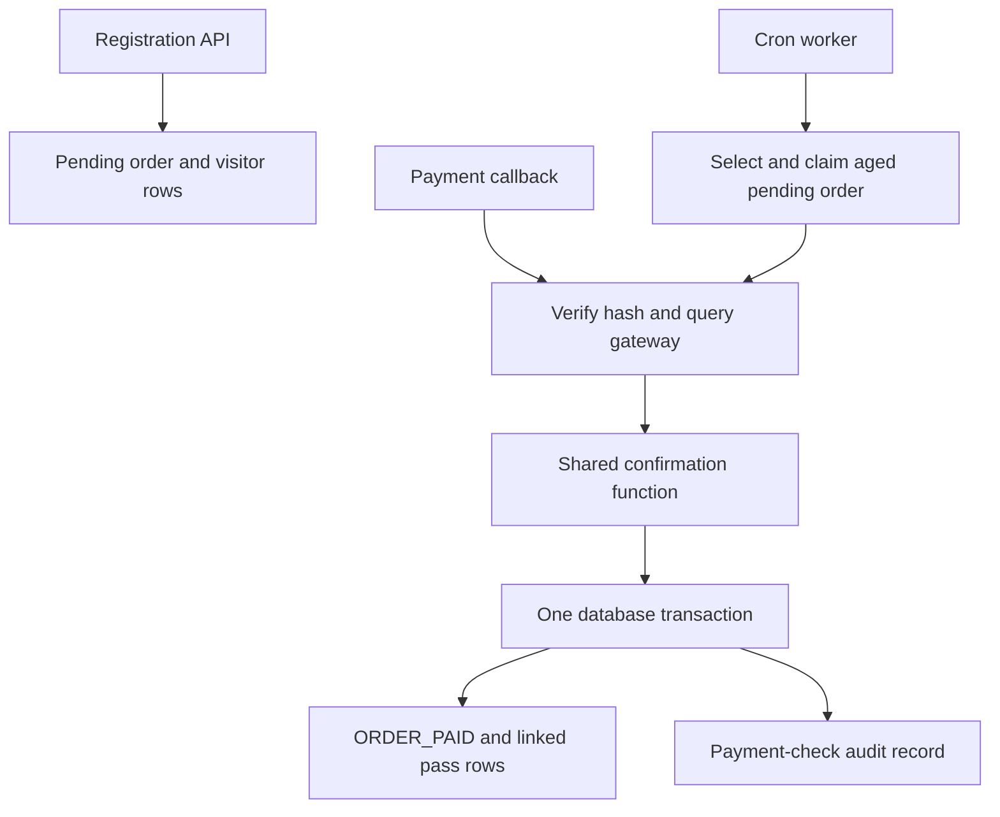
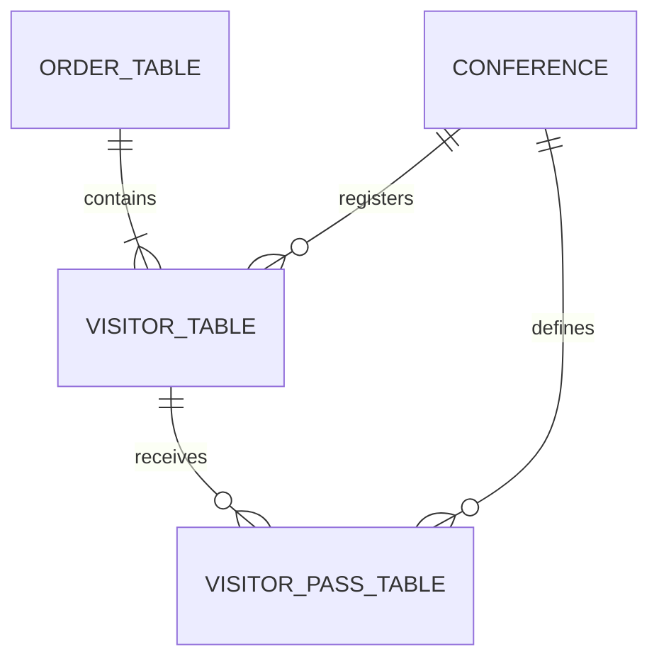

# Registration Payment Reconciliation

A runnable reconstruction of a production recovery workflow: **the customer paid, the payment notification was missed, and registration remained pending.** A scheduled worker independently verifies payment and completes registration without generating duplicate passes.

Built by Jasper Nathaniel as an engineering case study for backend and data-engineering interviews.

## Start here

```bash
python -m venv .venv
. .venv/bin/activate
pip install -r requirements.lock
pip install --no-deps -e .
python -m reconcile.walkthrough
```

Python 3.12 is required. The walkthrough starts two local HTTP services, uses temporary synthetic databases, demonstrates recovery and a delayed callback, checks the results, and shuts down. No merchant account, credentials, or real payment is needed.

Expected result:

```json
{
  "before": "ORDER_PENDING",
  "first_run": {"confirmed": 1},
  "second_run": {},
  "delayed_callback": {"outcome": "already_confirmed"},
  "after": {
    "orders_by_status": {"ORDER_PAID": 1},
    "passes": 1,
    "confirmed_amount_paise": 400000
  }
}
```

## The incident this demonstrates

Registration stored an order and visitor details before payment. Normally, a successful payment notification triggered confirmation and pass creation. When that notification was missed, paid registrations stayed pending. An existing cron-based recovery job checked older pending transactions with Worldline India and completed registration.

**Reported production impact:** approximately **5,000 registrations associated with ₹2 crore+ in successful payments**, as recalled by the author. This is not independently audited by this repository. The funds had already been paid; the recovery concerned registration confirmation and pass generation, not recovered lost funds or new revenue.

This is newly written demonstration code, not Showbay source code or a production database export. It uses synthetic people and payments. Table names and relationships were informed by prior SQL references. Transaction boundaries, leases, uniqueness constraints, tests and audit records are explicit reconstruction choices, not claims about the original implementation.

## How it works



1. Persist an order, a unique merchant payment reference, and its visitors.
2. A callback normally starts verification. Cron provides an independent recovery path.
3. Query the gateway **outside** a database transaction.
4. Check merchant, reference, expected amount and payment status.
5. Lock the order and perform status, pass and audit writes in one transaction.
6. Repeat notifications return the existing confirmation. Pending or unknown results do not generate passes.

No seat limit or reservation TTL is involved. Registration age decides when to check payment; it does not decide whether payment failed.

## Worldline contract

The implementation is informed by [Worldline India Checkout documentation](https://www.paynimo.com/paynimocheckout/docs/), reviewed on 23 October 2026. It models **Offline Verification, request type `O`**, and the documented signed Checkout callback format. It does not use mandate `TSI` APIs.

Read [the integration notes](docs/worldline-contract.md) before interpreting the simulator as a provider integration. Live Worldline endpoints are deliberately disabled. No actual Worldline sandbox or production account was exercised.

## Database

The PostgreSQL deployment uses these relationships:



- `visitor_table.order_id` connects a visitor to an order.
- `visitor_pass_table.visitor_id` and `conference_id` connect passes to visitors and conferences.
- The demo supports multiple visitors per order and one pass per visitor/conference. This cardinality is a reconstruction assumption.
- JSON fields preserve the earlier `visitor_data` and `pass_data` pattern. Amounts and operational status are typed columns.
- `merchant_reference` separates our order ID from the provider-facing reference.

[PostgreSQL DDL](docs/schema.sql) · [Design decisions](docs/design.md)

## Run with PostgreSQL

```bash
docker compose up --build -d db gateway api
docker compose exec api python -m reconcile.cli init-db
docker compose exec api python -m reconcile.cli demo --callback-url http://127.0.0.1:8000/callbacks/worldline
docker compose exec api python -m reconcile.cli report
```

Wait for the API at <http://127.0.0.1:8000/health> before running commands. Interactive API documentation: <http://127.0.0.1:8000/docs>.

Run one reconciliation batch:

```bash
docker compose exec api python -m reconcile.cli reconcile --limit 50
```

The example cron configuration is in [deploy/cron.example](deploy/cron.example). The optional `scheduled` Compose profile uses a simple 60-second loop for local convenience; it is not cron. The production case used cron.

## Verification

```bash
python -m pytest -q
python -m reconcile.benchmark --orders 5000
```

Tests exercise missing callbacks, concurrent confirmation, concurrent work claiming, crash rollback, lease recovery, pending results, mismatched evidence, malformed responses, retries and duplicate callbacks. See [validation results](docs/validation.md).

The synthetic benchmark exercises the actual worker/database path against an in-process mocked HTTP transport. It measures no real gateway throughput. [Recorded result](docs/benchmark-result.json).

For PostgreSQL tests, provision a **disposable** database and set `TEST_DATABASE_URL`. Tests drop the project's tables in that database. GitHub Actions is configured to run both SQLite and PostgreSQL tests; publishing the repository does not imply CI has passed.

## Scope

This repository demonstrates payment-status reconciliation and relational consistency. It does not reconcile bank settlements, create charges, issue refunds, send emails, render QR assets, or implement a checkout UI. A pass is a durable database record; delivery is a separate concern.

Local endpoints are unauthenticated and synthetic. Compose binds HTTP ports to loopback. Do not expose this demonstration as a public payment service. Production adaptation requires the merchant-specific integration contract, authentication/access control, rate limits, monitoring, retention policy, and verified account configuration.
