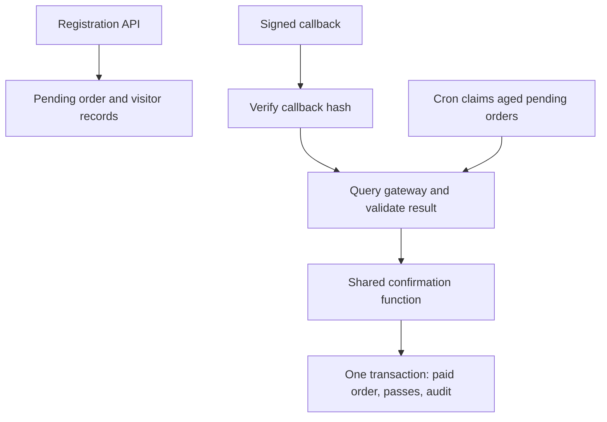

# Recovering paid registrations after missed payment notifications

A customer could pay successfully through Worldline India while their registration remained pending in our database. Their visitor details existed, but their pass had not been generated.

During my work at Showbay, I implemented cron-based reconciliation that checked older pending orders against the gateway and completed registration for verified payments. The recovery covered approximately **5,000 registrations associated with ₹2 crore+ in successful payments**.

This repository reconstructs that workflow with synthetic data. It demonstrates missed-notification recovery, atomic order/pass updates, and safe repeated processing. Production figures are my estimates; the repository's test results are reported separately. The explicit locking, leases and audit records are reconstruction choices.

## See it work

With Python 3.12:

```bash
python -m venv .venv
. .venv/bin/activate
pip install -r requirements.lock
pip install --no-deps -e .
python -m reconcile.walkthrough
```

The walkthrough starts two local HTTP services with temporary databases and shuts them down when finished. No merchant account or real payment is needed.

| Step | Expected result |
|---|---|
| Payment succeeds; notification is omitted | Order remains `ORDER_PENDING`; no pass exists |
| Reconciliation runs | Order becomes `ORDER_PAID`; one pass is created |
| Reconciliation runs again | No further changes |
| Delayed callback arrives | Returns `already_confirmed`; pass count stays at one |

## System flow



The registration is stored before payment. The normal callback and the recovery worker both use the same confirmation function. That function connects orders to visitors through `visitor_table.order_id`, then creates passes through `visitor_pass_table.visitor_id` and `conference_id`.

## Engineering decisions

| Choice | Reason |
|---|---|
| Cron checks older pending orders | Gives the normal notification flow time to finish and provides independent recovery |
| Query the gateway using the stored merchant reference | An absent notification leaves payment uncertain |
| Match merchant, reference and amount | A success result must belong to the expected registration |
| Share confirmation logic | Callback and cron apply identical rules |
| Commit status, pass and audit writes together | A crash cannot commit only part of a new confirmation |
| Lock the order and enforce unique passes | Repeated or concurrent processing preserves the existing result |
| Claim work with expiring leases | Another run can recover work after a worker crash |

Gateway calls happen outside database transactions. Pending or unknown results are retried; mismatches and repeatedly unresolved payments require review. No reservation TTL is needed for this registration flow.

## Evidence

[Passing SQLite and PostgreSQL CI run](https://github.com/Jappynathaniel/payment-reconciliation-demo/actions/runs/39936210072).

- **30 tests** cover missing and duplicate callbacks, concurrent confirmation, crash rollback, worker recovery, invalid evidence and per-order gateway failures.
- **Real HTTP walkthrough** demonstrates recovery and a harmless delayed callback against local services.
- **5,000 synthetic orders** produced exactly 5,000 passes; a repeated run made no changes.

The synthetic run took **35.1 seconds using SQLite and mocked HTTP responses**. It excludes gateway latency and rate limits; it is not a production throughput measurement. [Recorded benchmark](docs/benchmark-result.json) · [Validation details](docs/validation.md).

Run the checks:

```bash
python -m pytest -q
python -m reconcile.benchmark --orders 5000
```

## Read the case study

[**When payment succeeded but registration stayed pending**](docs/case-study.md) explains the original failure, recovery flow, tradeoffs and reconstruction evidence.

[Design details](docs/design.md) · [Database schema](docs/schema.sql) · [Three-minute interview walkthrough](docs/recruiter-walkthrough.md).

## PostgreSQL and scheduling

```bash
docker compose up --build -d db gateway api
```

Wait for <http://127.0.0.1:8000/health>, then run:

```bash
docker compose exec api python -m reconcile.cli demo --callback-url http://127.0.0.1:8000/callbacks/worldline
docker compose exec api python -m reconcile.cli report
```

API documentation: <http://127.0.0.1:8000/docs>. For one recovery batch:

```bash
docker compose exec api python -m reconcile.cli reconcile --limit 50
```

See [the cron example](deploy/cron.example) and [worker wrapper](deploy/run-reconciliation.sh). Adjust paths and make the wrapper executable before installing it. The optional `scheduled` Compose profile uses a 60-second loop for local convenience. The original workflow used cron.

## Integration boundaries

The simulator follows Worldline India Checkout's **Offline Verification (`O`)** contract and documented signed callback format. See [Worldline documentation](https://www.paynimo.com/paynimocheckout/docs/) and [integration notes](docs/worldline-contract.md).

This is newly written demonstration code with synthetic records. Live Worldline requests are disabled. Merchant-specific access, enquiry limits and date-lookup behaviour still require verification before a real integration.

A pass is a database record in this version. Email delivery, QR rendering, refunds and bank-settlement reconciliation are outside its scope. Local endpoints are unauthenticated and bound to loopback; the demo is not a public payment service. PostgreSQL tests pass in CI; Docker Compose startup has not been separately validated.
